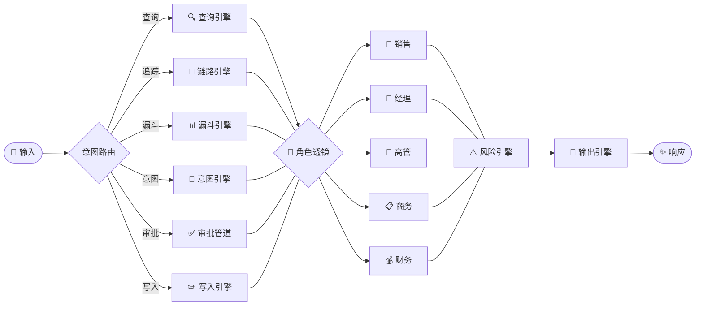
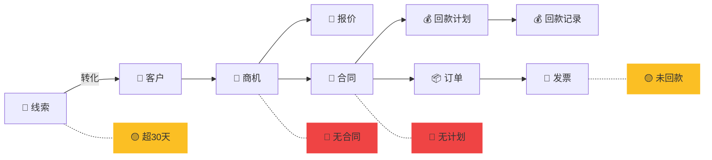

# Cordys CRM Skill

<p align="center">
  <br/>
  <em><strong>你的专属 AI 助手，告别在传统页面上点来点去</strong></em>
  <br/>
  <em>角色感知 &nbsp;·&nbsp; 管道原生 &nbsp;·&nbsp; 默认零信任</em>
  <br/><br/>
</p>

---

> 当前稳定版：`v1.2.12`（2026-10-31）。

## 同一个 CRM，不同的人看到不同的世界

同一个系统。同一份数据。同一个问题：*"看看线索"*

销售听到的是**待办优先级**。经理看到的是**团队健康仪表盘**。财务得到的是**资金回笼全景**。

Cordys CRM Skill 不是给 CRM 加一层界面，而是加一层**智能**——它理解*谁*在问、*卡在* L2C 链路的哪个环节。它说人话，跨模块推理，在你开口问之前就告诉你哪里不对劲。

> **一行配置。** 填好 API 密钥，系统自动识别你的身份、匹配角色、激活对应的认知视角。不用搭仪表盘，不用存筛选器。

---

## 五个角色，五种视角

不是偏好设置。是系统在"展示什么、先展示什么、以什么紧迫度展示"这三个维度上的本质切换。

<table>
<tr>
<td width="20%" valign="top">

### 销售
```
关注： 我接下来该做什么？
范围： 我的客户/线索/商机
预警： 超期未跟、商机卡顿
输出： 优先级行动清单
```
</td>
<td width="20%" valign="top">

### 经理
```
关注： 谁需要我关注？
范围： 全部门 + 子团队
预警： 跟进率低、转化骤降
输出： 团队看板 → 下钻到人
```
</td>
<td width="20%" valign="top">

### 高管
```
关注： 公司能交多少？
范围： 全公司
预警： 目标缺口、部门偏离
输出： 趋势 → 对比 → 预测
```
</td>
<td width="20%" valign="top">

### 商务
```
关注： 合同签对了没有？
范围： 合同 + 审批流
预警： 到期未续、审批卡顿
输出： 合同状态 + 到期预警
```
</td>
<td width="20%" valign="top">

### 财务
```
关注： 钱在哪？
范围： 合同 → 回款 → 发票
预警： 逾期、未开票、链断裂
输出： 应收全景 → 催收排序
```
</td>
</tr>
</table>

---

## 架构

不是一个巨型提示词。是一组目标明确的**引擎晶格**，按需加载，通过共享上下文总线协同工作。



**核心原则**：`role-engine.md` 是唯一启动必加载的引擎。其余全部按意图懒加载——保持上下文窗口精瘦。

---

## 引擎晶格

| 引擎 | 激活信号 | 职责 |
|------|---------|------|
| **角色** `role-engine` | 会话启动（唯一必载） | 身份识别、角色匹配、查询范围判定、身份缓存 |
| **查询** `query-engine` | 任何列表/统计 | 查询生成顺序、表单同步、结果核验 |
| **CLI 规范** `cli-spec` + 专题 | 构造命令 | 分页结构、意图→命令、模块推断；专题：条件、成员/部门、池、视图、全局搜索、审批、价格目录 |
| **CLI 参考** `cli-reference` | 复杂筛选 | 字段类型→操作符速查、审批/写入端点 |
| **输出** `output-engine` | 每次响应 | JSON → 人类可读、角色自适应格式化 |
| **风险** `risk-engine` | 数据展示后 | 单模块异常 + 跨模块链断裂检测 |
| **链路** `linkage-engine` | "查这笔单子" / "360视图" | L2C 正向追溯 / 反向溯源 |
| **漏斗** `funnel-engine` | "管道怎么样" / "转化率" | 基于 page/page-summary 的聚合、快照与趋势 |
| **意图** `intent-engine` | "今天做什么" | 模糊意图 → 角色工作流路由 |
| **写入** `write-engine` | "创建" / "修改" / "转化" | 表单同步→校验→确认→写入→验证 |

---

## L2C 管道 —— 从线索到现金，一气贯通

线索 → 客户 → 商机 → 报价 → 合同 → 订单 → 回款计划 → 回款记录 → 发票



每一个环节转换都是**可能的断裂点**。系统监控整条链路，在问题变成事故之前主动暴露——不只是单模块内，而是跨 L2C 全局。

### 链断裂检测示例

| 断裂场景 | 检测方式 | 严重度 |
|---------|---------|--------|
| 线索创建 > 30 天未转化 | 查线索无关联客户 | 🟡 警告 |
| 商机赢单 > 15 天无合同 | 赢单商机 vs 合同模块交叉比对 | 🔴 严重 |
| 合同签约无回款计划 | 合同 vs 回款计划交叉比对 | 🔴 严重 |
| 已开发票 > 90 天未回款 | 发票 vs 回款记录交叉比对 | 🔴 严重 |
| 客户 > 90 天无跟进记录 | 客户跟进记录时间交叉检查 | 🟡 警告 |

---

## 业务操作能力

除了查询和统计，技能还覆盖常见 CRM 写入和数据准备流程：

| 能力 | 入口 | 说明 |
|------|------|------|
| 统计 | `scripts/cordys.sh crm page` / `crm page-summary` | 纯计数读 `data.total`；金额/分组/排名/分布本地流式聚合，不拉全量明细进上下文 |
| 查重 | `scripts/cordys_ext.sh check` | 创建前检索 6 个分类，任一命中即提醒可能存在冲突 |
| 创建 | `scripts/cordys_ext.sh create` | 支持线索、客户、商机、联系人创建 |
| 合同生成订单 | `scripts/cordys.sh crm create order @-` | 按产品类型 + 收入类型自动拆单；同一业务产品可跨子表合并，名称模板不变，全部成功后回写合同标记 |
| 跟进新增 | `scripts/cordys_ext.sh follow` / `follow-plan` | 新增拜访跟进记录或跟进计划，保存返回 ID 供后续查询和更新 |
| 跟进更新 | `scripts/cordys_ext.sh follow-update` / `follow-plan-update` | 先读取条目详情并合并完整请求体，再更新内容、时间、方式、跟进人、联系人或意向产品 |
| 线索转客户 | `scripts/cordys_ext.sh transform` | 按 SOP 补字段并转换 |
| 省市转换 | `scripts/cordys_ext.sh loc` | 本地查询行政代码，避免全文读取 JSON |
| 部门展开 | `scripts/cordys.sh crm org ids [部门名称或ID]` | 按名称或 ID 获取部门及所有子部门 ID；不传部门时返回全部可见部门 |
| 成员名单 | `scripts/cordys.sh crm members '<JSON>' --active --compact` | `departmentIds` 可只传父部门；CLI 默认递归全部子部门，`--exact-departments` 才只查直属 |
| 字段同步 | `scripts/cordys_ext.sh sync` | 同步表单字段到 `references/forms/` |

写入类动作遵循对应写入流程：新增跟进记录/计划可直接执行；更新已有跟进条目及其他修改操作必须先展示变更并等待用户确认。删除操作不提供。

---

## 实际体验

### 销售 —— 晨会速览

```
> 今天有什么要跟的？

📋 今日跟进计划（3 项）
| 客户 | 内容 | 优先级 |
| YYY集团 | 确认需求 | 🚨 超期5天 |
| 华星科技 | 发送报价 | ⚠️ 今日到期 |
| ABC技术 | 初次联系 | 🟢 新线索 |

📊 我的管线：线索12 / 商机4（¥52万） / 签约1（¥12万）
💡 商机"XX项目"在需求确认阶段停留10天，建议推进
```

### 经理 —— 周会看板

```
> 团队这周怎么样？

📊 团队 L2C 漏斗（本周）
| 成员 | 新增线索 | 新增商机 | 签约 | 签约额 |
| 张三 | 8 | 2 | 1 | ¥12万 |
| 李四 | 5 | 1 | 0 ⚠️ | ¥0 |
| 王五 | 12 | 4 | 2 | ¥35万 🏆 |

🚨 李四本周签约为零，跟进率 40% < 团队均值 68%
📋 2 条待审批超过 3 天未处理
💡 建议 1v1 了解李四管线卡点
```

### 财务 —— 应收全景

```
> 欠款情况

💰 应收账款全景
汇总：总应收 ¥285万 | 已逾期 ¥45万 🚨 | 7天内到期 ¥62万 ⚠️

🚨 逾期回款（3 笔）
| 合同 | 客户 | 逾期 | 金额 |
| CRM-001 | 华星 | 15天 | ¥15万 |
| CRM-008 | 远航 | 32天 | ¥20万 |
| CRM-012 | 星辰 | 8天 | ¥10万 |

⚠️ 链断裂：2份签约合同未创建回款计划（¥55万）
```

### 写入 —— 创建客户（含表单校验）

```
> 创建一个客户：华星科技，行业科技，广东

📋 已获取客户表单定义（12 个字段，3 项必填）

⚠️  即将创建客户「华星科技」

| 字段 | 值 |
|------|-----|
| 名称 | 华星科技 |
| 行业 | 科技 |
| 省份 | 广东 |
| 负责人 | 当前用户（默认） |

确认创建？（是/修改/取消）

> 是

✅ 已创建客户「华星科技」
🔗 cordys.sh crm get account 987654321
```

---

## 安全姿态

| 原则 | 实现 |
|------|------|
| **默认零信任** | API 请求仅发往已配置的 `CORDYS_CRM_DOMAIN` |
| **凭证隔离** | 密钥存 `.env`，永不进版本控制，永不出现于输出 |
| **非信任域拦截** | 跨域请求默认拒绝，除非显式设 `CORDYS_ALLOW_UNTRUSTED=1` |
| **输出脱敏** | Access Key / Secret Key 在所有可见输出中自动剥离 |
| **最小权限兜底** | 角色匹配失败时降级为 `sales`（最受限视角） |
| **写入保护** | 先取表单定义再校验再写入；绝对禁止任何删除操作 |

---

## 快速开始

```bash
# Clawdhub 安装（推荐）
clawdhub install cordys-crm

# 手动安装（OpenClaw）
git clone --branch main https://github.com/1Panel-dev/CordysCRM-skills \
  ~/.openclaw/workspace/skills/CordysCRM-skills
mv ~/.openclaw/workspace/skills/CordysCRM-skills/skills/cordys-crm-f2c \
  ~/.openclaw/workspace/skills/cordys-crm-f2c
rm -rf ~/.openclaw/workspace/skills/CordysCRM-skills
```

```bash
# WorkBuddy 安装
# 版本固定为 1.2.12；未经维护者明确授权，禁止修改版本号
# 只打包 Git 跟踪的技能文件，产物固定写入仓库上级目录：
python package_skill.py
# → cordys-crm-v1.2.12.zip
# zip 根目录为 cordys-crm-f2c/，不能包含 skills/ 外层、.env 或本地 Python 运行时
```

```bash
# 配置
vi ~/.openclaw/workspace/skills/cordys-crm-f2c/.env

# 必填
CORDYS_ACCESS_KEY=***
CORDYS_SECRET_KEY=***
CORDYS_CRM_DOMAIN=https://你的域名

# 可选：自定义角色映射
ROLE_MAP=总经理|副总裁|VP=executive,总监|经理=sales-manager,商务|合同管理=contract-admin,销售|顾问=sales,财务|会计|出纳=finance
```

---

## CLI 速查

```bash
# 主 CLI
scripts/cordys.sh crm whoami
scripts/cordys.sh crm verify
scripts/cordys.sh crm page lead '{"viewId":"SELF"}'
scripts/cordys.sh crm search account '{"keyword":"华星科技"}'
scripts/cordys.sh crm page lead '{"current":1,"pageSize":1,"viewId":"SELF","combineSearch":{"searchMode":"AND","conditions":[]}}'
scripts/cordys.sh crm page-summary opportunity '{"sum":["amount"],"groupBy":["stage"],"topN":20}' '{"viewId":"SELF","combineSearch":{"searchMode":"AND","conditions":[]}}'
scripts/cordys.sh crm date-range 2026-07-01 2026-07-31
scripts/cordys.sh crm acct-sub payment-record-stat ACCOUNT_ID
scripts/cordys.sh crm contract-sub invoice-stat CONTRACT_ID
scripts/cordys.sh crm org ids 苏皖线下团队
scripts/cordys.sh crm members '{"departmentIds":["销售一部ID","销售二部ID","销售三部ID"]}' --active --compact
printf '%s' '{"contractId":"合同ID","moduleFields":[]}' | scripts/cordys.sh crm create order @-

# 扩展 CLI
scripts/cordys_ext.sh check '{"客户名":"华星科技"}'
scripts/cordys_ext.sh sync-if-needed
scripts/cordys_ext.sh follow '<JSON>'
scripts/cordys_ext.sh transform '<JSON>'
scripts/cordys_ext.sh loc 杭州
```

---

## 仓库结构

```
├── .workbuddy-plugin/
│   └── plugin.json           # ★ WorkBuddy 专家配置
├── agents/
│   └── cordys-crm.md         # ★ Agent 定义文件（以 SKILL.md 为准的薄封装）
├── avatars/
│   └── expert.png            # 专家头像
├── package_skill.py          # 版本锁定的打包脚本
├── README.md
│
└── skills/
    └── cordys-crm-f2c/       # 技能子模块（打包根目录）
        ├── SKILL.md          # 入口：触发、路由、加载策略、红线
        ├── registry.json     # 技能清单
        ├── .env              # API 凭证（不入库）
        ├── Cordys.md         # 运行时身份缓存（不入库）
        │
        ├── core/             # 引擎晶格
        │   ├── role-engine.md          # 🧠 身份 → 角色 → 查询范围
        │   ├── query-engine.md         # 🧭 查询生成顺序与核验
        │   ├── cli-spec.md             # ⚙️ 查询语义入口（分页、意图、模块）
        │   ├── query-conditions.md     #    条件构造与时间过滤
        │   ├── query-members-org.md    #    人名 / 部门范围 / 层级
        │   ├── query-pools.md          #    私海 / 线索池 / 公海
        │   ├── query-views.md          #    视图 viewId
        │   ├── query-global-search.md  #    全局模糊搜索 vs 查重 vs 360
        │   ├── approval.md             #    审批
        │   ├── price-catalog.md        #    价格目录 / SKU
        │   ├── cli-reference.md        # 📖 字段类型 → 操作符速查 + 端点
        │   ├── output-engine.md        # 🧾 JSON → 人类可读格式化
        │   ├── risk-engine.md          # ⚠️ 异常检测（单模块 + 跨模块链断裂）
        │   ├── linkage-engine.md       # 🔗 L2C 链路 / Customer 360
        │   ├── funnel-engine.md        # 📊 统计与漏斗
        │   ├── intent-engine.md        # 🧭 意图路由
        │   └── write-engine.md         # ✏️ 创建 / 更新 / 批量 / 转化 / 公海
        │
        ├── profiles/         # 角色定义（范围、口径、工作流配方）
        │   ├── sales.md / sales-manager.md / executive.md
        │   └── contract-admin.md / finance.md
        │
        ├── sop/              # 专项流程
        │   ├── duplicate-check.md      # 查重
        │   ├── inference-rules.md      # 字段推断
        │   ├── visit-flow.md           # 跟进记录 / 计划
        │   ├── order-operations.md     # 订单创建 / 拆单 / 完整导出
        │   └── quote-linking.md        # 报价关联：quote-context / 一张确认表 / 为报价新建商机
        │
        ├── rules/            # 自定义规则扩展点（字段映射已启用，其余为占位）
        │
        ├── scripts/
        │   ├── cordys.sh               # 主 CLI（查询 / 统计 / 写入 / 审批）
        │   ├── cordys_ext.sh           # 扩展 CLI（查重 / 转化 / 跟进 / 公海 / 同步）
        │   ├── cordys.py               # 备用 Python CLI（不支持 page-summary）
        │   └── sop/*.py                # 查询契约、写入核验、拆单、报价上下文、同步等实现
        │
        └── references/
            ├── crm-api.md              # 原始 API 端点与响应结构
            ├── platform-notes.md       # Windows / WorkBuddy 注意事项
            ├── field-schema.json       # CLI 校验用字段快照（sync 生成）
            ├── forms/*.md              # 各模块字段 / 选项 / 视图目录（sync 生成）
            └── mappings/               # 跟进方式、产品简称、行业、行政区划
```

---

## 设计思路

> **不是数据浏览器，是智能层。**

- **角色变形**：不问你是谁，自己判断。在说出第一个字之前，输出已经适配了你的角色。
- **管道原生**：L2C 不是"功能模块"，是系统的脊柱。每一次查询、每一次预警、每一条工作流，都锚定在这条链上。
- **引擎晶格**：精小引擎各司其职，每条规则只在一个文件维护。用到才加载，用不到不浪费注意力。
- **先于提问的预警**：风险检测是主动的。系统主动告诉你你没注意到的，而不是等你来问。
- **业务闭环**：覆盖查重、创建、转换、跟进、字段同步和本地映射能力。
- **无头设计**：轻量 CLI 调用 REST API。无 UI 依赖，可嵌入任何环境。
